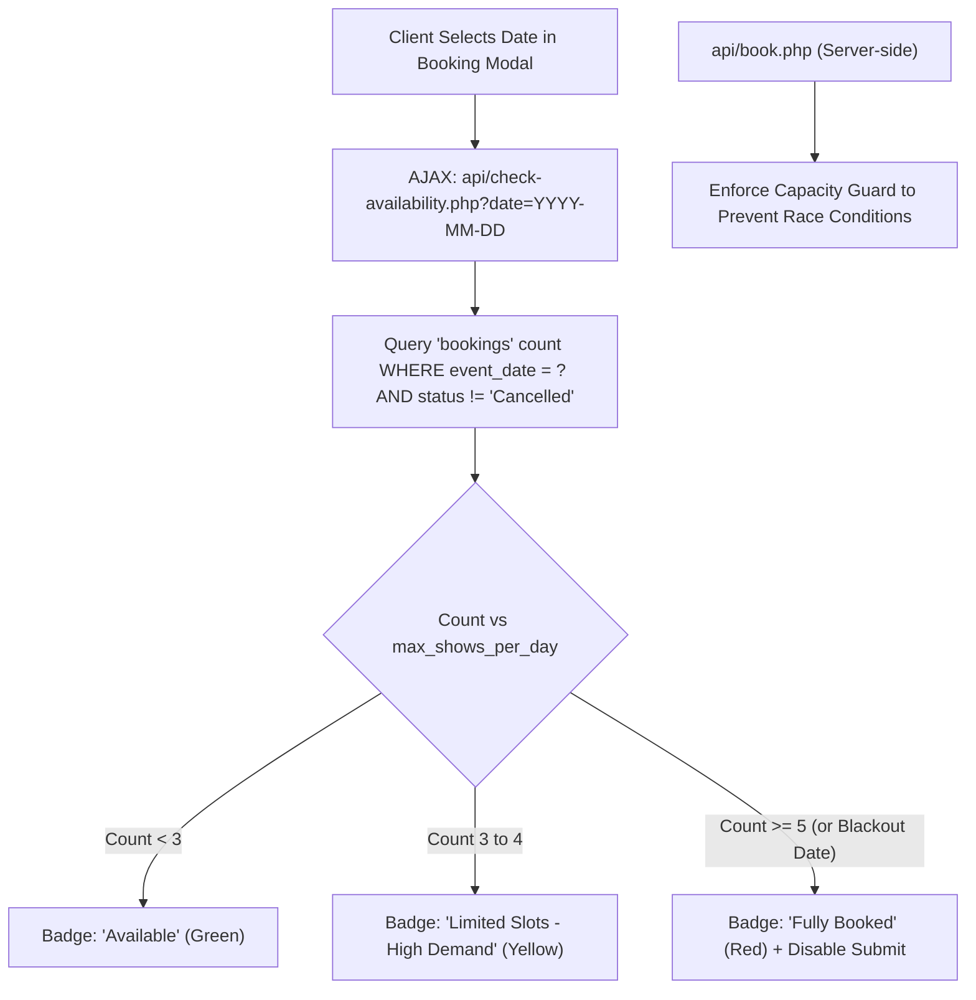
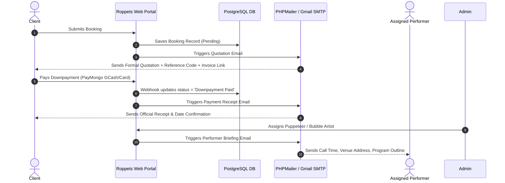

# Roppets Edutainment Production Inc. — Phase 3 & Phase 4 Roadmap

This document outlines the detailed architecture, specifications, and execution steps for **Phase 3** (Live Date Capacity & Double-Booking Limiter) and **Phase 4** (Automated Gmail / SMTP Email Notifications).

---

## 📅 Phase 3: Live Date Capacity & Double-Booking Limiter

### 1. Objective
Ensure that Roppets production teams (puppeteers, sound technicians, bubble artists, mascot performers) are never double-booked beyond operational capacity on any single day.

### 2. Architecture & Components



### 3. Key Specifications

* **System Setting Configuration (`system_settings` table):**
  - `max_shows_per_day`: Default `5` (configurable by admin in `admin/settings.php`).
  - `blackout_dates`: Comma-separated or JSON list of closed dates (e.g. Christmas Day, New Year, Good Friday).

* **Real-Time API Endpoint (`api/check-availability.php`):**
  - **Inputs:** `?date=YYYY-MM-DD`
  - **Outputs:**
    ```json
    {
      "success": true,
      "date": "2026-10-25",
      "slots_booked": 3,
      "max_capacity": 5,
      "remaining_slots": 2,
      "status": "High Demand",
      "can_book": true
    }
    ```

* **Frontend Datepicker Feedback (`includes/booking-modal.php` & `assets/js/main.js`):**
  - Instant visual badge adjacent to the Date input:
    - 🟢 **Available (Green)**: Plenty of crew slots available.
    - 🟡 **High Demand (Yellow)**: Only 1-2 slots left.
    - 🔴 **Fully Booked (Red)**: Date closed; submit button disabled with prompt to choose another date.

* **Backend Validation Guard (`api/book.php`):**
  - Atomic verification before inserting new booking to prevent edge-case double bookings.

---

## ✉️ Phase 4: Automated Gmail / SMTP Email Notification System

### 1. Objective
Automatically deliver professional, branded HTML emails to clients and production staff during key lifecycle events without manual intervention.

### 2. Architecture & Triggers



### 3. Email Templates & Modules

1. **Email Helper Engine (`includes/mailer.php`):**
   - Configured via Gmail SMTP credentials stored in `system_settings`:
     - `smtp_host`: `smtp.gmail.com`
     - `smtp_port`: `587` (TLS) / `465` (SSL)
     - `smtp_user`: `edutainment@roppets.com` / Gmail App Password
     - `smtp_sender_name`: `Roppets Edutainment Production Inc.`

2. **Template 1: Instant Booking & Formal Quotation:**
   - **Trigger:** Immediately upon booking submission via modal or custom package form.
   - **Contents:** Reference Code (`ROP-2026-XXXX`), show details, date, payment terms (50% downpayment), and direct button to `invoice.php`.

3. **Template 2: Official Downpayment Receipt & Schedule Confirmation:**
   - **Trigger:** PayMongo Webhook verification or manual admin payment approval.
   - **Contents:** Verified Amount (`₱5,750.00`), remaining balance on event day, and preparation reminders.

4. **Template 3: Performer & Crew Event Briefing:**
   - **Trigger:** Admin assigns performer team in `admin/assign.php`.
   - **Contents:** Event call time, venue address, client contact person, assigned acts (*Hand Puppet Plays, Bubble Factory, Mascot*).

---

## 🚀 Execution Sequence

1. **Step 1:** Implement **Phase 3** (Capacity Checker API, Modal Date Badge, and Double-Booking Guard).
2. **Step 2:** Test date slot edge cases and verify booking limiter.
3. **Step 3:** Implement **Phase 4** (Gmail SMTP Integration, Email Templates, and Auto-Dispatch triggers).
